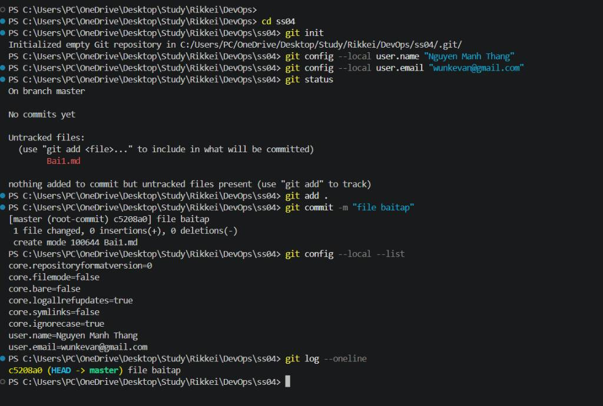

# Báo cáo Bài tập 1: Khởi tạo Local Repository và Cấu hình danh tính

## 1. Các lệnh Git đã thực hiện

### Bước 1: Khởi tạo Git Repository cục bộ trong thư mục bài tập
```bash
# Di chuyển vào thư mục bài tập ss04
cd ss04

# Khởi tạo một Git repository trống
git init
```
*Kết quả phản hồi từ Git:* `Initialized empty Git repository in C:/Users/PC/OneDrive/Desktop/Study/Rikkei/DevOps/ss04/.git/`

### Bước 2: Cấu hình danh tính ở cấp độ cục bộ (Local)
Sử dụng tùy chọn `--local` để cấu hình riêng cho dự án này mà không ảnh hưởng đến cấu hình hệ thống:
```bash
# Cấu hình tên tác giả
git config --local user.name "Nguyen Manh Thang"

# Cấu hình email tác giả
git config --local user.email "wunkevan@gmail.com"
```

### Bước 3: Tạo tệp tin mới và kiểm tra trạng thái thư mục
Sau khi tạo tệp `Bai1.md`, tiến hành kiểm tra trạng thái thư mục làm việc:
```bash
git status
```
*Kết quả:* Git nhận diện được tệp `Bai1.md` nằm trong danh sách các tệp chưa được theo dõi (*Untracked files*).

### Bước 4: Đưa tệp tin vào vùng chuẩn bị và thực hiện Commit đầu tiên
```bash
# Đưa toàn bộ thay đổi vào Staging Area
git add .

# Thực hiện commit đầu tiên với thông điệp rõ nghĩa
git commit -m "file baitap"
```
*Kết quả:* Tạo thành công root-commit với mã hash `c5208a0`.

---

## 2. Kết quả kiểm tra hệ thống (Minh chứng)

### Kiểm tra cấu hình danh tính cục bộ
```bash
git config --local --list
```

Kết quả đầu ra thực tế:
```text
core.repositoryformatversion=0
core.filemode=false
core.bare=false
core.logallrefupdates=true
core.symlinks=false
core.ignorecase=true
user.name=Nguyen Manh Thang
user.email=wunkevan@gmail.com
```

### Kiểm tra lịch sử Commit bằng định dạng rút gọn
```bash
git log --oneline
```

Kết quả đầu ra thực tế:
```text
c5208a0 (HEAD -> master) file baitap
```

---

## 3. Ảnh chụp màn hình quá trình thực hiện



---

